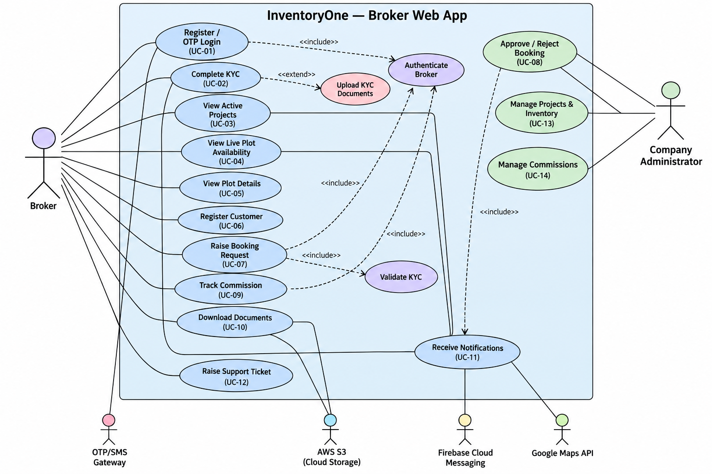

# Experiment 4: Software Requirement Specification (SRS)

## Aim

To prepare a complete Software Requirement Specification (SRS) document for the selected software project — **InventoryOne: Broker Web App** — covering the overall description, functional requirements, non-functional requirements, interfaces, constraints, and other applicable requirements.

## Objectives

- Document a complete and unambiguous set of requirements for the InventoryOne Broker Web App.
- Describe the overall product perspective, functions, user classes, and operating environment.
- Specify functional, non-functional, interface, and constraint requirements.
- Serve as a contractual reference for design, development, and testing.
- Trace requirements to the user stories defined in the product backlog.

## Introduction

The Software Requirement Specification is the primary deliverable of the requirements analysis phase. It establishes a shared understanding between the stakeholders (brokers, the company administrator, and the development team) and forms the baseline against which the system is designed, implemented, and validated.

---

# 1. Introduction

## 1.1 Purpose

This document specifies the requirements for **InventoryOne: Broker Web App**, a real-estate platform that allows registered brokers to view live plot inventory, register customers, raise booking requests, track commissions, and receive notifications. It is intended for the development team, the company administrator, testers, and project evaluators.

## 1.2 Scope

InventoryOne enables:

- OTP-based broker registration and login.
- Broker KYC verification (PAN, Aadhaar, GST, cancelled cheque, RERA number, bank details).
- Viewing active projects with live, colour-coded plot availability.
- Viewing plot details (size, facing, PLC, BSP, total cost, discount).
- Customer registration and booking requests with company approval.
- Commission tracking (percentage, TDS, net payable).
- Document downloads, notifications, and support tickets.
- Administrative management of projects, inventory, bookings, and commissions.

Out of scope: a customer-facing portal, loan processing, customer account creation, and native mobile applications.

## 1.3 Definitions, Acronyms and Abbreviations

| Term      | Meaning                                                        |
| --------- | ------------------------------------------------------------- |
| OTP       | One-Time Password used for login verification                 |
| KYC       | Know Your Customer verification                               |
| PAN       | Permanent Account Number                                      |
| GST       | Goods and Services Tax identification number                  |
| RERA      | Real Estate Regulatory Authority registration number          |
| PLC       | Preferential Location Charge                                  |
| BSP       | Base Selling Price (per square yard)                          |
| TDS       | Tax Deducted at Source                                        |
| Token     | Initial booking amount paid by the customer                   |
| DRF       | Django REST Framework                                         |
| SRS       | Software Requirement Specification                            |

## 1.4 References

- InventoryOne Project README (product backlog, user stories US01–US12).
- Experiment 2: Problem Identification and Feasibility Analysis (`docs/feasibility-analysis.md`).
- SE & DP Lab Manual, Odd Semester (2026–27).

## 1.5 Overview

Section 2 describes the product and its users. Section 3 lists the functional requirements. Section 4 covers external interfaces. Section 5 defines non-functional requirements. Section 6 lists constraints.

---

# 2. Overall Description

## 2.1 Product Perspective

InventoryOne is a new, self-contained web application built as a client–server system:

- **Frontend:** Next.js + TypeScript single-page web application.
- **Backend:** Django REST Framework REST API.
- **Database:** PostgreSQL accessed through the Django ORM.
- **Real-time:** Django Channels + Redis for live availability updates.
- **Supporting services:** Firebase Auth/FCM, AWS S3 (documents), Google Maps API, Celery + Redis (background jobs), Django Admin (administration).

The system interacts with external services (OTP/SMS gateway, Firebase, S3, Maps) but the software running on those services is not part of this specification.

## 2.2 Product Functions

1. Register and authenticate brokers using OTP.
2. Capture and validate broker KYC and bank details.
3. Maintain projects and plot inventory.
4. Display live, colour-coded plot availability.
5. Show plot details and pricing.
6. Register customers against a broker.
7. Raise booking requests (token amount + payment mode).
8. Approve or reject booking requests (administrator).
9. Compute and track commissions with TDS.
10. Download documents (price lists, forms).
11. Send notifications for projects, schemes and booking updates.
12. Raise support tickets and contact the relationship manager.

## 2.3 User Classes and Characteristics

| User Class             | Description                                             | Technical Skill | Frequency of Use |
| ---------------------- | ------------------------------------------------------- | --------------- | ---------------- |
| Broker                 | External sales partner who books plots for customers    | Basic           | Daily            |
| Company Administrator  | Company staff managing projects, inventory and bookings | Moderate        | Daily            |
| Operator (Admin)       | Maintains the machine/back-office configuration         | Moderate        | Occasional       |

## 2.4 Operating Environment

- Web browsers: latest Chrome, Firefox, Edge, Safari (desktop and mobile).
- Server: Linux-based cloud host (AWS / Render / Railway).
- Database: PostgreSQL 14 or later.
- Cache/message broker: Redis.

## 2.5 Design and Implementation Constraints

- Frontend must use Next.js + TypeScript; backend must use Django + DRF.
- Data must be stored in PostgreSQL and accessed through the Django ORM.
- Passwords and OTPs must never be stored in plain text in logs.
- KYC documents must be stored in secure object storage (AWS S3).
- The system must follow responsive web design for desktop and mobile browsers.

## 2.6 Assumptions and Dependencies

- Brokers possess a valid mobile number and e-mail for OTP delivery.
- The company maintains accurate project and plot master data.
- Third-party OTP, maps, and messaging services remain available.
- Payment gateway selection is pending and does not block the booking workflow.

---

# 3. Functional Requirements

Each requirement is traced to the corresponding user story.

## 3.1 Broker Authentication

| ID    | Requirement                                                          | Traces to |
| ----- | ------------------------------------------------------------------- | --------- |
| FR-01 | The system shall allow a broker to register using an e-mail/mobile.  | US01      |
| FR-02 | The system shall send a one-time password (OTP) for verification.    | US01      |
| FR-03 | The system shall authenticate the broker only on a valid OTP.        | US01      |
| FR-04 | The system shall expire an OTP after a fixed validity period.        | US01      |

## 3.2 KYC Verification

| ID    | Requirement                                                                    | Traces to |
| ----- | ------------------------------------------------------------------------------ | --------- |
| FR-05 | The system shall allow the broker to upload PAN, Aadhaar, GST and cancelled cheque. | US02  |
| FR-06 | The system shall capture RERA number and bank account details.                 | US02      |
| FR-07 | The system shall record broker agreement acceptance.                           | US02      |
| FR-08 | The system shall display the broker profile/KYC status.                        | US02      |

## 3.3 Projects and Inventory

| ID    | Requirement                                                                | Traces to |
| ----- | -------------------------------------------------------------------------- | --------- |
| FR-09 | The system shall list all active projects with their details.              | US03      |
| FR-10 | The system shall display plot availability with colour coding.            | US04      |
| FR-11 | Colour coding shall be: green = available, amber = on hold, red = sold/booked. | US04 |
| FR-12 | The system shall display plot details including size, facing, PLC, BSP, total cost and discount. | US05 |

## 3.4 Customers

| ID    | Requirement                                                              | Traces to |
| ----- | ------------------------------------------------------------------------ | --------- |
| FR-13 | The system shall allow a broker to register customer details.            | US06      |
| FR-14 | Each customer shall be linked to the registering broker.                 | US06      |

## 3.5 Bookings

| ID    | Requirement                                                                     | Traces to |
| ----- | ------------------------------------------------------------------------------- | --------- |
| FR-15 | The system shall allow a broker to raise a booking request for an available plot. | US07    |
| FR-16 | A booking request shall capture token amount and payment mode.                  | US07      |
| FR-17 | Raising a booking shall place the plot on hold.                                  | US04/07   |
| FR-18 | The administrator shall approve or reject booking requests.                      | US08      |
| FR-19 | On approval the plot shall be marked as sold; on rejection it shall be released. | US08      |

## 3.6 Commissions

| ID    | Requirement                                                                     | Traces to |
| ----- | ------------------------------------------------------------------------------- | --------- |
| FR-20 | The system shall compute broker commission on an approved booking.              | US09      |
| FR-21 | The system shall deduct TDS and display the net payable amount.                 | US09      |
| FR-22 | The broker shall be able to track commission and payment status.                | US09      |

## 3.7 Documents, Notifications and Support

| ID    | Requirement                                                            | Traces to |
| ----- | ---------------------------------------------------------------------- | --------- |
| FR-23 | The system shall allow brokers to download documents and forms.        | US10      |
| FR-24 | The system shall notify brokers about new projects, schemes and booking updates. | US11 |
| FR-25 | The system shall allow a broker to raise support tickets.              | US12      |
| FR-26 | The system shall display relationship manager contact details.         | US12      |

## 3.8 Administration

| ID    | Requirement                                                     | Traces to |
| ----- | --------------------------------------------------------------- | --------- |
| FR-27 | The administrator shall manage projects and plot inventory.     | —         |
| FR-28 | The administrator shall manage commissions and releases.        | —         |
| FR-29 | The administrator shall generate demand letters.                | —         |

---

# 4. External Interface Requirements

## 4.1 User Interfaces

- Responsive web UI built with Next.js and TypeScript.
- Broker screens: login, dashboard, projects, plot grid, plot details, customers, bookings, commissions, documents, notifications, support.
- Administrator screens: project management, inventory management, booking approvals, commission management.
- Colour palette: green = available, amber = on hold, red = sold/booked.

## 4.2 Hardware Interfaces

- Standard client device (desktop/laptop/mobile) with a modern browser.
- No specialized hardware is required by the broker.

## 4.3 Software Interfaces

| Interface        | Purpose                                   |
| ---------------- | ----------------------------------------- |
| PostgreSQL       | Persistent data storage via Django ORM    |
| Redis            | Caching and Channels message broker       |
| Firebase Auth    | Optional identity provider                |
| Firebase Cloud Messaging | Push notifications                |
| AWS S3           | Storage of KYC and project documents      |
| Google Maps API  | Project location and map display          |
| OTP/SMS Gateway  | Delivery of one-time passwords            |
| Payment Gateway  | Token payment processing (to be finalized) |

## 4.4 Communication Interfaces

- HTTPS for all client–server and third-party communication.
- REST over JSON for API calls.
- WebSockets (Django Channels) for real-time availability updates.

---

# 5. Non-Functional Requirements

| ID     | Category        | Requirement                                                                       |
| ------ | --------------- | --------------------------------------------------------------------------------- |
| NFR-01 | Usability       | The system shall be simple and intuitive, requiring minimal broker training.      |
| NFR-02 | Performance     | Project and inventory operations shall respond within 2 seconds under normal load. |
| NFR-03 | Security        | Unauthorized users shall not access administrative functions; all traffic shall use HTTPS. |
| NFR-04 | Security        | OTPs and KYC data shall be protected and never logged in plain text.              |
| NFR-05 | Reliability     | Booking and commission data shall be stored without loss (transactional integrity). |
| NFR-06 | Scalability     | The system shall support additional projects, plots, brokers and concurrent users. |
| NFR-07 | Maintainability | The source code shall be modular and documented.                                 |
| NFR-08 | Responsiveness  | The broker interface shall work correctly on desktop and mobile browsers.         |
| NFR-09 | Availability    | The platform shall be available 24×7 with minimal downtime.                      |
| NFR-10 | Auditability    | Booking approvals and commission releases shall be traceable with timestamps.     |

---

# 6. Constraints

- The chosen technology stack (Next.js, Django + DRF, PostgreSQL) is mandatory.
- Real-time updates require a running Redis instance.
- KYC document upload requires configured S3 storage.
- Notifications require Firebase Cloud Messaging configuration.
- Payment integration is pending and may be added in a later sprint.

---

# Appendix: Traceability Matrix

| User Story | Requirement IDs         |
| ---------- | ----------------------- |
| US01       | FR-01 … FR-04           |
| US02       | FR-05 … FR-08           |
| US03       | FR-09                   |
| US04       | FR-10, FR-11, FR-17     |
| US05       | FR-12                   |
| US06       | FR-13, FR-14            |
| US07       | FR-15, FR-16, FR-17     |
| US08       | FR-18, FR-19            |
| US09       | FR-20 … FR-22           |
| US10       | FR-23                   |
| US11       | FR-24                   |
| US12       | FR-25, FR-26            |

---

## Observation

A complete SRS was prepared for the InventoryOne: Broker Web App, clearly separating functional, non-functional, interface and constraint requirements, and tracing each functional requirement to the product backlog user stories.

## Result

The Software Requirement Specification for the InventoryOne: Broker Web App was successfully prepared and serves as the baseline for subsequent design, implementation, and testing activities.

