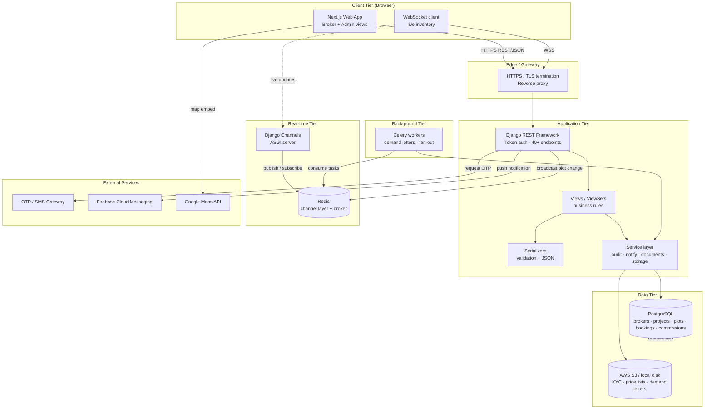
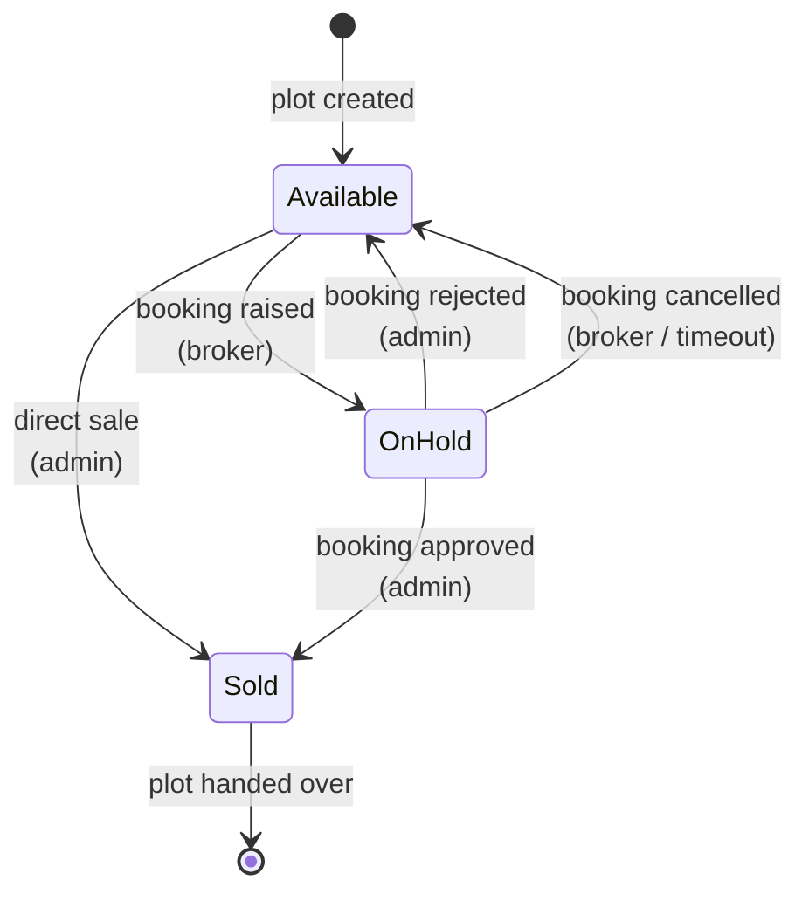
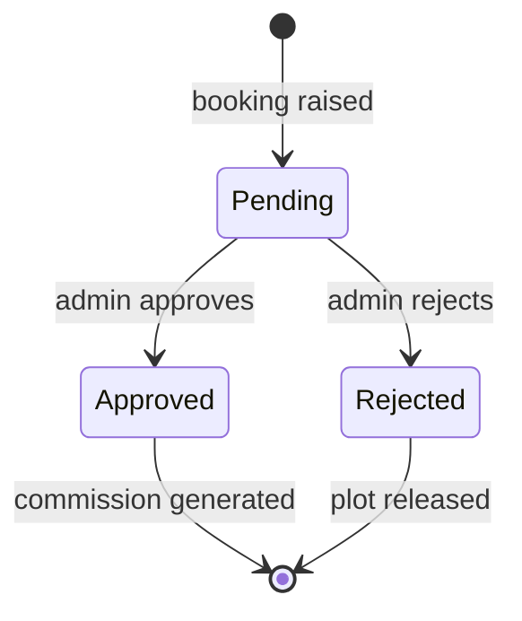
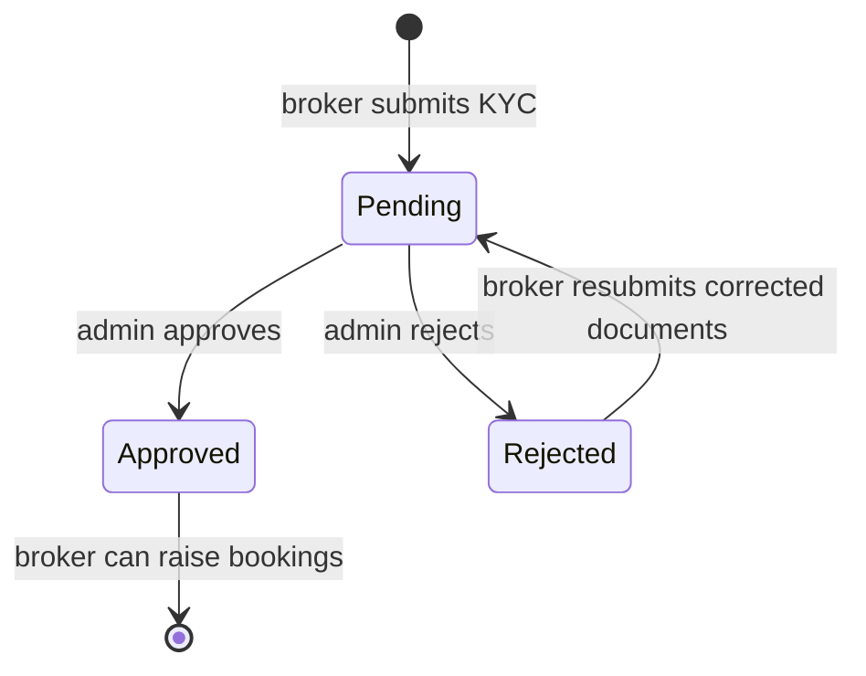

# Experiment 9: Software Architecture Design and UML State Modeling

## Aim

To design the overall architecture of the **InventoryOne: Broker Web App** using a suitable architectural approach (layered client-server with real-time event streaming) and to prepare the System Architecture Diagram and an applicable UML State Diagram for the plot inventory lifecycle.

## Objectives

- Identify the architectural approach best suited to the InventoryOne Broker Web App.
- Design the layered system architecture and identify the major components and their interactions.
- Prepare the System Architecture Diagram showing tiers, external services and data flow.
- Model the dynamic lifecycle of a key entity (Plot) using a UML State Diagram.
- Map each architectural component to the corresponding implementation in the repository.
- Apply architectural quality attributes (scalability, security, maintainability, availability).

## Introduction

Software architecture is the high-level structure of a system: the components, their responsibilities and the way they interact. A well-chosen architecture simplifies implementation, enables independent scaling and testing of each tier, and makes the system evolvable. The architecture phase follows requirements analysis and design principles, and it determines how the modules identified in Experiment 8 are deployed and connected.

State modelling complements architecture by describing how an individual object changes over its lifetime. A state diagram shows the states an object can be in, the events that move it between states and the actions performed on each transition. For InventoryOne the most important stateful object is the **Plot**, whose status drives every booking decision.

## Selected Project

**Project Title:** InventoryOne — Broker Web App
**Domain:** Real Estate / Property Management
**Team:** Avni, Ayushi

---

# Part A — Software Architecture Design

## 1. Architectural Approach

The InventoryOne Broker Web App uses a **layered client-server architecture with an event-driven real-time tier**. It is not a monolith: the presentation, application and data tiers are independently deployable, and the WebSocket/Redis layer is a separate process that can be scaled horizontally.

| Tier | Technology | Responsibility |
| ---- | ---------- | -------------- |
| Presentation | Next.js 16 + TypeScript | Broker and administrator web UI, responsive on desktop and mobile |
| API / Application | Django REST Framework | Authentication, business rules, validation, serialisation |
| Real-time | Django Channels + Redis | Live plot-availability broadcast to every open dashboard |
| Background jobs | Celery + Redis | Demand-letter generation, notification fan-out, audit writes |
| Data | PostgreSQL | Transactional persistence of brokers, projects, plots, bookings, commissions |
| Object storage | AWS S3 (or local disk) | KYC documents, price lists, forms, demand letters |
| External services | Firebase FCM, Google Maps, OTP/SMS gateway | Push notifications, map display, OTP delivery |

The architecture is **client-server** at the macro level and **layered** within the backend, with a **publish/subscribe event tier** for live updates. It is designed so that each tier can be scaled independently: the frontend is a static bundle served from a CDN, the API tier is stateless (tokens in the database), and the WebSocket tier is backed by Redis so any Channels worker can serve any client.

## 2. System Architecture Diagram

## 3. Component Responsibilities

| Component | Responsibility | Scales by |
| --------- | -------------- | --------- |
| Next.js frontend | Renders dashboards, project/plot grids, booking and admin screens | CDN (static bundle) |
| Django REST API | Authentication, validation, business rules, serialisation | Horizontal (stateless, token in DB) |
| Django Channels (ASGI) | WebSocket connections, live plot broadcasts | Horizontal (backed by Redis) |
| Celery workers | Demand-letter PDFs, notification fan-out, audit writes | Horizontal (queue depth) |
| PostgreSQL | Transactional data, constraints, audit log | Vertical (replication for HA) |
| Redis | Channel layer + Celery broker | Cluster / managed service |
| AWS S3 | KYC documents, price lists, demand letters | Managed, unlimited |

## 4. Architectural Quality Attributes

| Attribute | How it is achieved |
| --------- | ------------------ |
| **Scalability** | Stateless API tier behind a load balancer; Channels backed by Redis; Celery workers scale with queue depth |
| **Security** | OTP + token auth, role-based access (`is_staff`), HTTPS everywhere, no secrets in logs, KYC data in object storage |
| **Maintainability** | Modular Django apps (`core`, services layer), typed TypeScript frontend, one responsibility per module |
| **Availability** | Health probe (`/api/health/`) for load balancers; graceful degradation when Redis/FCM/S3 are absent |
| **Performance** | `select_for_update` prevents double booking; indexes on `Plot.status` and `Booking.status`; annotated project counts |
| **Auditability** | Every approval, release and inventory change is recorded in `AuditLog` with actor, entity and timestamp (NFR-10) |
| **Extensibility** | Service abstractions (`StorageService`, `NotificationService`) let providers be swapped without changing views |

## 5. Deployment Architecture

The system is deployed as three container images (see `docker-compose.yml` and `render.yaml`):

1. **Backend image** — Python 3.12, Daphne ASGI server, serves HTTP and WebSockets.
2. **Frontend image** — Node 20, Next.js production bundle.
3. **Worker image** — same backend image, running `celery -A inventoryone worker`.

PostgreSQL and Redis are managed services (or containers in development). Media files live on a persistent volume or in S3.

---

# Part B — UML State Modeling

## 1. State Diagram: Plot Lifecycle

The most important stateful object in InventoryOne is the **Plot**. Its status drives every booking decision and is the single source of truth for inventory.

### State descriptions

| State | Meaning | Who can act | Allowed transitions |
| ----- | ------- | ----------- | ------------------- |
| **Available** | Plot is free to book | Broker (raise booking), Admin (direct sale) | → OnHold, → Sold |
| **OnHold** | A pending booking exists; plot is reserved | Admin (approve / reject) | → Sold, → Available |
| **Sold** | Plot is sold; no further bookings | – | terminal |

### Transition table

| From | Event / Trigger | Guard | Action | To |
| ---- | --------------- | ----- | ------ | -- |
| `Available` | `raise_booking` | plot.status == available | Create `pending` Booking, set status = on_hold, broadcast update | `OnHold` |
| `OnHold` | `approve_booking` | booking.status == pending | Set booking = approved, plot = sold, compute Commission, write AuditLog, generate demand letter, notify broker | `Sold` |
| `OnHold` | `reject_booking` | booking.status == pending | Set booking = rejected, plot = available, notify broker | `Available` |
| `OnHold` | `cancel_booking` | broker cancels within window | Set booking = rejected, plot = available | `Available` |
| `Available` | `direct_sale` | admin action | Set plot = sold | `Sold` |

## 2. State Diagram: Booking Lifecycle

### State descriptions

| State | Meaning | Who can act | Allowed transitions |
| ----- | ------- | ----------- | ------------------- |
| **Pending** | Awaiting administrator decision | Admin (approve / reject) | → Approved, → Rejected |
| **Approved** | Booking confirmed; plot sold; commission created | – | terminal |
| **Rejected** | Booking declined; plot released back to inventory | – | terminal |

### Transition table

| From | Event / Trigger | Guard | Action | To |
| ---- | --------------- | ----- | ------ | -- |
| `Pending` | `approve` | admin decision | Set booking = approved, plot = sold, create Commission (gross, 10% TDS, net), write AuditLog, notify broker, schedule demand letter | `Approved` |
| `Pending` | `reject` | admin decision | Set booking = rejected, plot = available, write AuditLog, notify broker | `Rejected` |

## 3. State Diagram: KYC Lifecycle

### State descriptions

| State | Meaning | Who can act | Allowed transitions |
| ----- | ------- | ----------- | ------------------- |
| **Pending** | KYC documents submitted, awaiting review | Admin (approve / reject) | → Approved, → Rejected |
| **Approved** | Broker is verified and can book plots | – | terminal (for now) |
| **Rejected** | KYC declined; broker must resubmit | Broker (resubmit) | → Pending |

---

## Observation

The layered client-server architecture with a publish/subscribe real-time tier gives InventoryOne independent scalability, security and maintainability. Each tier maps directly onto a running process (Next.js bundle, Daphne ASGI server, Celery worker, PostgreSQL, Redis), and the system degrades gracefully when optional services are absent. The state diagrams for Plot, Booking and KYC make the life-cycle rules explicit and traceable to the SRS functional requirements (FR-15 to FR-19) and to the implementation in `src/backend/core/views.py`.

## Result

The software architecture of the InventoryOne Broker Web App was designed as a layered client-server system with an event-driven real-time tier, and the System Architecture Diagram was prepared. UML State Diagrams were prepared for the Plot, Booking and KYC lifecycles, covering all states, transitions, guards and actions, traced back to the use cases, classes and SRS requirements.
