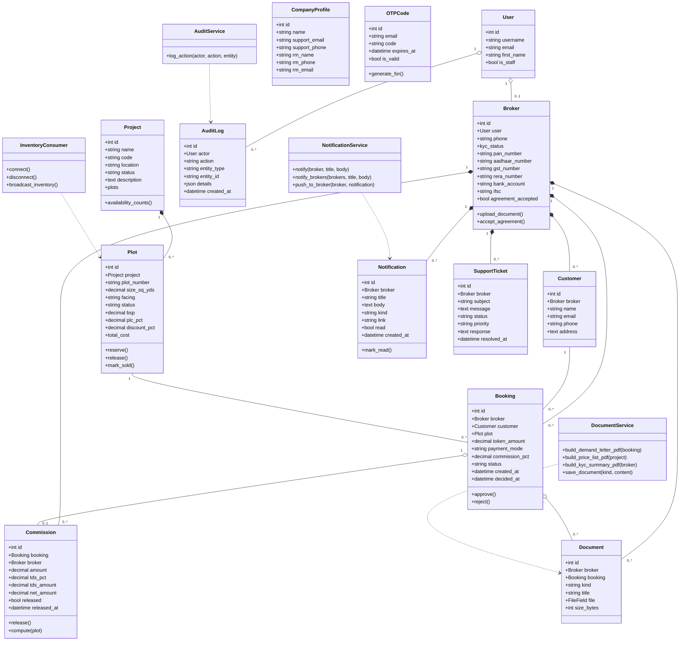

# Class Diagram

The object-oriented model of the InventoryOne Broker Web App. Django models map
directly onto the classes below; the service objects on the right are plain
Python modules in `core/services/`.

## Responsibility notes

| Class | Responsibility | Depends on |
| ----- | -------------- | ----------- |
| `Broker` | Broker identity, KYC state and agreement acceptance | `User` |
| `Plot` | Inventory state machine and pricing arithmetic | `Project` |
| `Booking` | Booking lifecycle (pending → approved / rejected) | `Broker`, `Customer`, `Plot` |
| `Commission` | Commission and TDS computation, release tracking | `Booking`, `Broker` |
| `Document` | File metadata for KYC uploads and generated PDFs | `Broker`, `Booking` |
| `Notification` | Per-broker message feed | `Broker` |
| `SupportTicket` | Broker support requests and company responses | `Broker` |
| `AuditLog` | Immutable traceability record | `User` |

The three service objects are stateless and depend only on the models, which keeps
them independently testable and avoids duplicating notification, PDF and audit logic
across the view layer.
