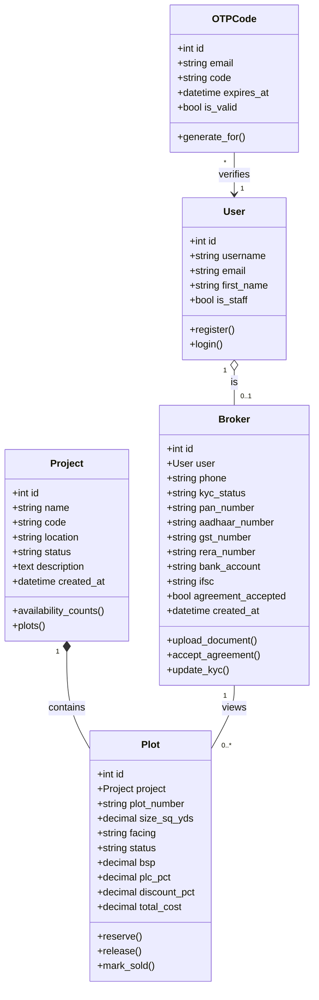
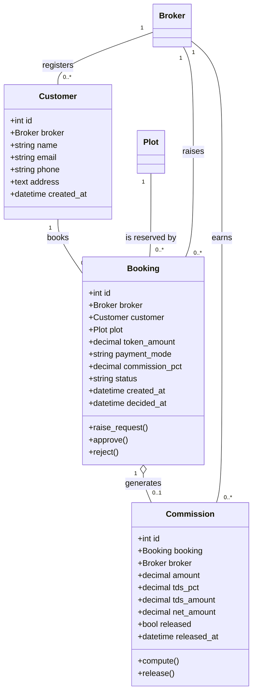
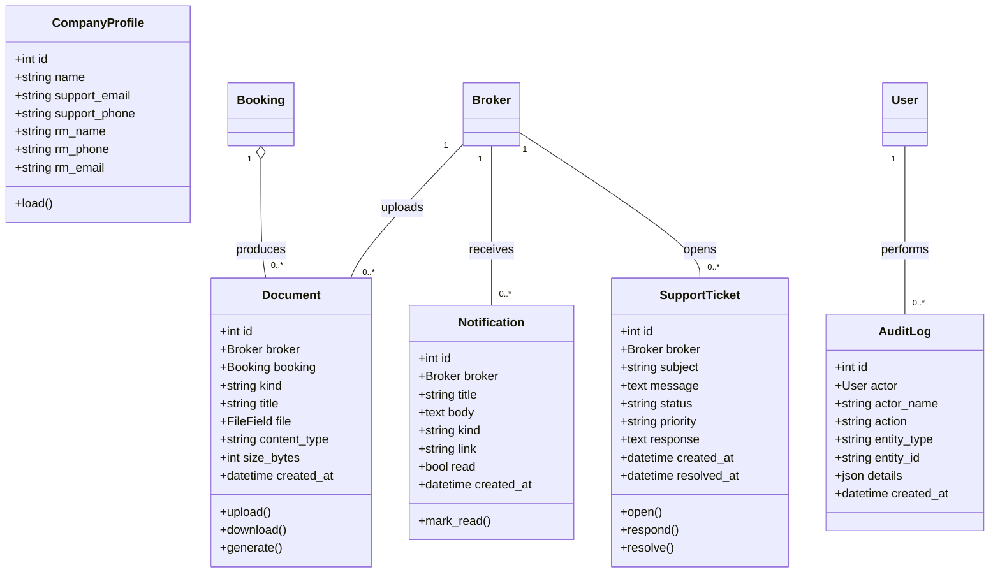
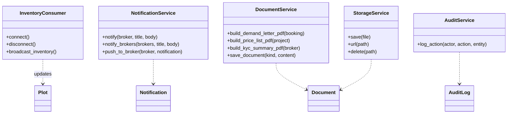

# Experiment 6: Class Diagram

## Aim

To design the UML Class Diagram of the **InventoryOne: Broker Web App** by identifying its classes, attributes, operations and the relationships among them, based on the SRS (Experiment 4) and the use case model (Experiment 5).

## Objectives

- Identify classes from the nouns and responsibilities in the SRS and use cases.
- Define attributes, operations and visibility for each class.
- Show relationships: association, aggregation, composition, generalization, realization and dependency, with multiplicity.
- Apply object-oriented design principles (abstraction, encapsulation, inheritance, SOLID) to the class structure.
- Prepare class diagrams and a description of every class and relationship.

## Introduction

A class diagram is a static structure diagram of UML. It shows the classes of a system, their attributes and operations, and the relationships between them. It is the main bridge between requirements (what the system must do) and implementation (the classes that will be coded), and it is the basis for the database schema and the back-end. For InventoryOne the classes map directly onto the Django models in `src/backend/core/models.py`.

## Selected Project

**Project Title:** InventoryOne — Broker Web App
**Domain:** Real Estate / Property Management
**Team:** Avni, Ayushi

---

## Identification of Classes

Classes were found by noun analysis of the SRS and use case descriptions: each noun was classified as a class, an attribute of a class, or rejected (a technology or a screen, not a business concept). Operations came from the verbs and the functional requirements.

| Noun / Concept in SRS | Decision | Reason |
| --------------------- | -------- | ------ |
| User, broker | Class: `User` (Django) + `Broker` | Principal actor with an account and profile |
| Administrator | Class: `User` with `is_staff = true` | A user with extra management operations |
| OTP, one-time password | Class: `OTPCode` | Short-lived verification record with expiry |
| Project, layout | Class: `Project` | Practice content with code, location and status |
| Plot, inventory | Class: `Plot` | A plot owns its pricing and status |
| Customer | Class: `Customer` | Buyer linked to the registering broker |
| Booking, booking request | Class: `Booking` | Records a broker's request to reserve a plot |
| Commission, earning | Class: `Commission` | Computed from an approved booking, with TDS |
| Document, price list, form, demand letter | Class: `Document` | A stored file attached to a broker or booking |
| Notification, alert | Class: `Notification` | A message delivered to a broker |
| Support ticket | Class: `SupportTicket` | A broker's request for help |
| Company, relationship manager | Class: `CompanyProfile` (singleton) | Holds company and RM contact details |
| Audit log, trace | Class: `AuditLog` | Immutable record of every action |
| Browser, PostgreSQL, Redis, Next.js | Rejected | Technology / infrastructure, not a domain class |
| Dashboard, login screen | Rejected | User-interface elements, not business concepts |

---

## Class Diagram 1: Users, Projects and Inventory

This diagram models the broker, the project and the plot inventory with its pricing.

## Class Diagram 2: Customers, Bookings and Commissions

This diagram models the booking lifecycle and the commission that an approved booking generates.

## Class Diagram 3: Documents, Notifications, Support and Audit

This diagram models the supporting entities that keep brokers informed and the
company accountable.

## Class Diagram 4: Service Layer and Real-time Abstraction

This diagram shows the design-layer classes from Experiment 8. The booking and
commission flows depend on the `NotificationService` and `StorageService`
abstractions rather than on concrete implementations, so the providers can be
replaced without changing the views.

---

## Description of Classes

### Domain (Entity) Classes

| Class | Responsibility | Key Attributes / Operations |
| ----- | -------------- | --------------------------- |
| `User` | Represents a registered person with an account | `id`, `username`, `email`, `first_name`, `is_staff`; `register()`, `login()`, `logout()` |
| `Broker` | A user who sells plots on behalf of the company, with KYC and bank details | `id`, `user`, `phone`, `kyc_status`, `pan_number`, `aadhaar_number`, `gst_number`, `rera_number`, `bank_account`, `ifsc`, `agreement_accepted`, `created_at`; `upload_document()`, `accept_agreement()`, `update_kyc()` |
| `OTPCode` | Short-lived verification record with expiry | `id`, `email`, `code`, `expires_at`, `is_valid`; `generate_for(email)` |
| `Project` | A real-estate layout with code, location and status | `id`, `name`, `code`, `location`, `status`, `description`, `created_at`; `availability_counts()`, `plots()` |
| `Plot` | A single plot with size, facing, pricing and status | `id`, `project`, `plot_number`, `size_sq_yds`, `facing`, `status`, `bsp`, `plc_pct`, `discount_pct`, `total_cost`; `reserve()`, `release()`, `mark_sold()` |
| `Customer` | A buyer linked to the registering broker | `id`, `broker`, `name`, `email`, `phone`, `address`, `created_at` |
| `Booking` | A broker's request to reserve a plot for a customer | `id`, `broker`, `customer`, `plot`, `token_amount`, `payment_mode`, `commission_pct`, `status`, `created_at`, `decided_at`; `raise_request()`, `approve()`, `reject()` |
| `Commission` | Earnings computed from an approved booking, with TDS | `id`, `booking`, `broker`, `amount`, `tds_pct`, `tds_amount`, `net_amount`, `released`, `released_at`; `compute()`, `release()` |
| `Document` | A stored file: KYC upload, price list, form or demand letter | `id`, `broker`, `booking`, `kind`, `title`, `file`, `content_type`, `size_bytes`, `created_at`; `upload()`, `download()`, `generate()` |
| `Notification` | A message delivered to a broker | `id`, `broker`, `title`, `body`, `kind`, `link`, `read`, `created_at`; `mark_read()` |
| `SupportTicket` | A broker's request for help | `id`, `broker`, `subject`, `message`, `status`, `priority`, `response`, `created_at`, `resolved_at`; `open()`, `respond()`, `resolve()` |
| `AuditLog` | Immutable traceability record of every action | `id`, `actor`, `actor_name`, `action`, `entity_type`, `entity_id`, `details`, `created_at` |
| `CompanyProfile` | Singleton holding company and relationship manager details | `id`, `name`, `support_email`, `support_phone`, `rm_name`, `rm_phone`, `rm_email`; `load()` |

### Service and Interface Classes

| Class | Responsibility | Key Operations |
| ----- | -------------- | -------------- |
| `InventoryConsumer` | WebSocket consumer that broadcasts plot status changes to all open dashboards | `connect()`, `disconnect()`, `broadcast_inventory()` |
| `NotificationService` | Creates notifications and attempts FCM push delivery | `notify()`, `notify_brokers()`, `push_to_broker()` |
| `DocumentService` | Generates PDFs (demand letters, price lists, KYC summaries) | `build_demand_letter_pdf()`, `build_price_list_pdf()`, `build_kyc_summary_pdf()`, `save_document()` |
| `AuditService` | Writes immutable audit entries | `log_action()` |
| `StorageService` | Abstracts local disk vs AWS S3 for file storage | `save()`, `url()`, `delete()` |

---

## Relationships Between Classes

| Source | Relationship | Target | Multiplicity | Meaning |
| ------ | ------------ | ------ | ------------ | ------- |
| `Administrator` | Generalization | `User` | – | An administrator is a user with `is_staff = true` |
| `Broker` | Generalization | `User` (via `user` FK) | 1 to 1 | A broker has exactly one user account |
| `Project` | Composition | `Plot` | 1 to 0..* | Plots exist only within a project |
| `Broker` | Association | `Customer` | 1 to 0..* | A broker registers many customers |
| `Customer` | Association | `Booking` | 1 to 0..* | A customer makes many bookings |
| `Plot` | Association | `Booking` | 1 to 0..* | A plot may be booked many times over its life |
| `Booking` | Composition | `Commission` | 1 to 0..1 | A commission exists only for an approved booking |
| `Booking` | Composition | `Document` | 1 to 0..* | Demand letters belong to a booking |
| `Broker` | Association | `Document` | 1 to 0..* | A broker uploads KYC documents |
| `Broker` | Association | `Notification` | 1 to 0..* | A broker receives many notifications |
| `Broker` | Association | `SupportTicket` | 1 to 0..* | A broker opens many tickets |
| `User` | Association | `AuditLog` | 1 to 0..* | A user performs many auditable actions |
| `NotificationService` | Dependency | `Notification` | – | Uses the `Notification` class |
| `DocumentService` | Dependency | `Document` | – | Uses the `Document` class |
| `AuditService` | Dependency | `AuditLog` | – | Uses the `AuditLog` class |
| `InventoryConsumer` | Dependency | `Plot` | – | Reads and broadcasts plot status |
| `StorageService` | Dependency | `Document` | – | Stores and retrieves document files |

---

## Design Principles Applied

- **Abstraction:** `StorageService` hides whether files are on local disk or S3; `NotificationService` hides FCM details.
- **Encapsulation:** attributes are accessed through public operations (`reserve()`, `release()`, `mark_sold()`, `compute()`, `release()`).
- **Single Responsibility:** each service class has one job (authentication, scoring, code evaluation, logging, notification, document generation).
- **Interface Segregation and Dependency Inversion:** the views depend on service abstractions (`NotificationService`, `AuditService`) rather than concrete implementations, so providers can be swapped.
- **Composition for life-cycle dependency:** commission, audit log and demand letter exist only with their owner (booking, action or project).
- **Liskov Substitution:** `available`, `on_hold` and `sold` plots can replace one another through the `status` field.

## Observation

The class diagrams give a clear static structure that covers every use case and maps directly onto the Django models in `src/backend/core/models.py`. Splitting the model into four diagrams (users/inventory, customers/bookings, documents/support/audit, and the service layer) keeps each diagram readable. Using service abstractions for storage and notifications keeps coupling low and makes the platform easy to extend, for example with a new payment gateway or another notification provider.

## Result

The UML Class Diagram of the InventoryOne Broker Web App was successfully prepared, with classes, attributes, operations, relationships and multiplicities, and each class and relationship was described and traced to the use cases and SRS requirements.
