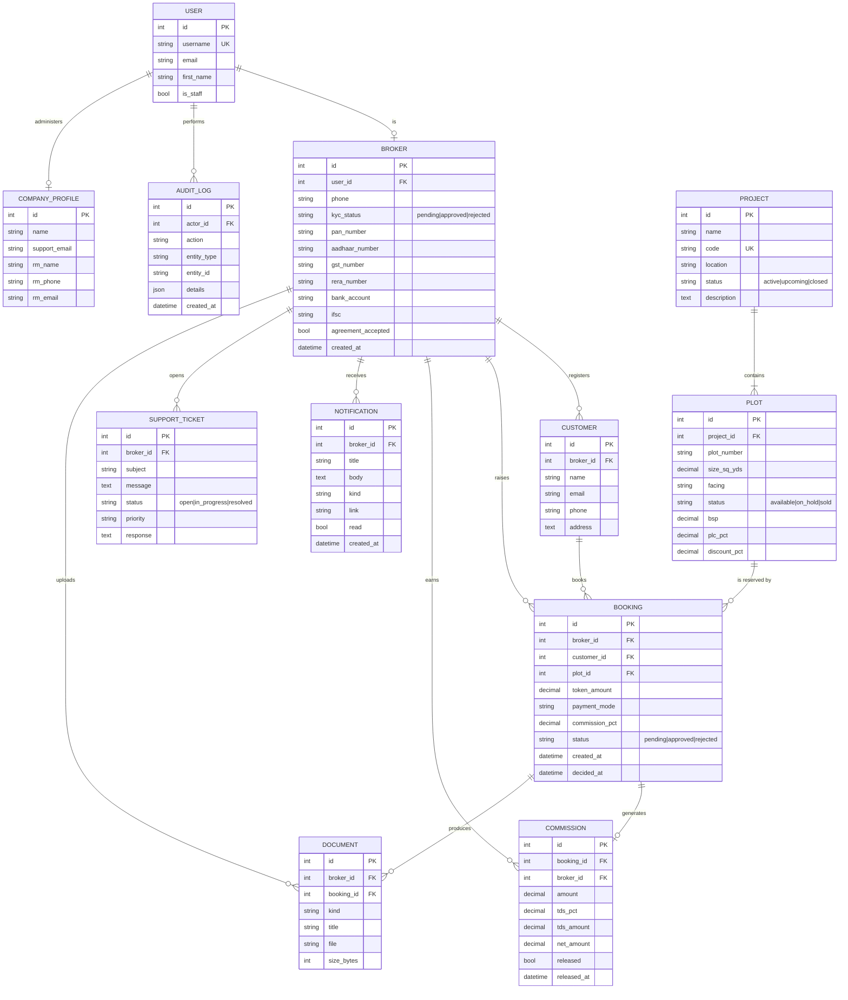

# Entity Relationship Diagram

The InventoryOne data model centres on the **Plot**: every booking, document and
commission ultimately references a plot inside a project.

## Cardinality notes

- A **User** has at most one **Broker** profile; administrators are `User` rows with
  `is_staff = true` and no broker profile.
- A **Project** owns many **Plots**. A plot number is unique *within* a project
  (`uniq_plot_per_project`).
- A **Plot** may appear in many **Bookings** over time, but at most one booking may be
  `pending` at a time (`uniq_open_booking_per_plot`). Historical bookings stay for audit.
- A **Booking** produces at most one **Commission**, created only when the administrator
  approves it.
- **Documents** attach either to a broker (KYC uploads, price lists) or to a booking
  (generated demand letters).
- Every **AuditLog** entry records an action against an entity so approvals and
  commission releases stay traceable (SRS NFR-10).
