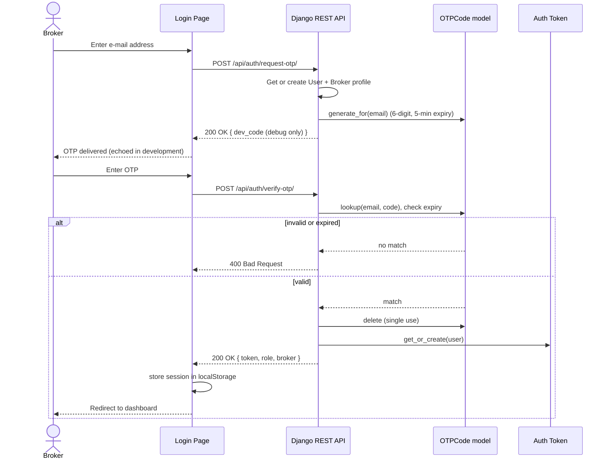
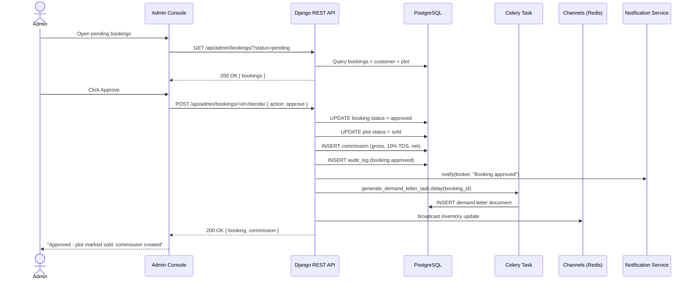
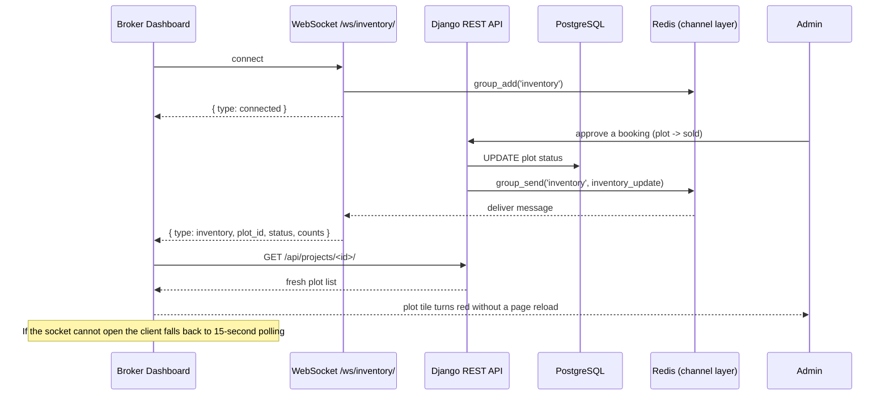
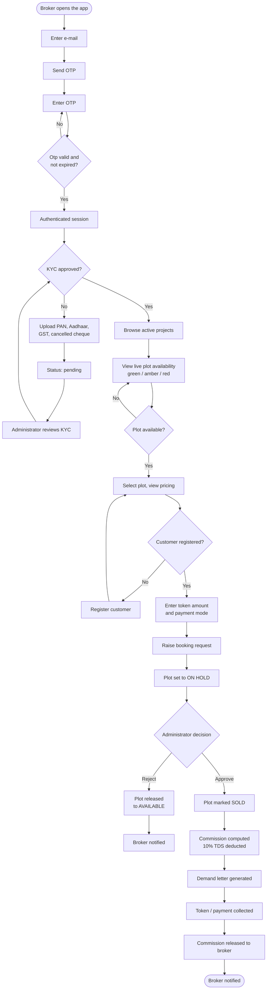
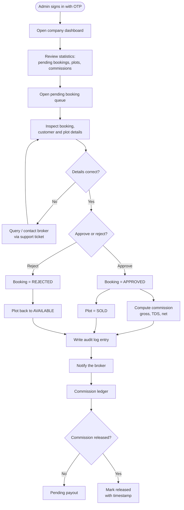
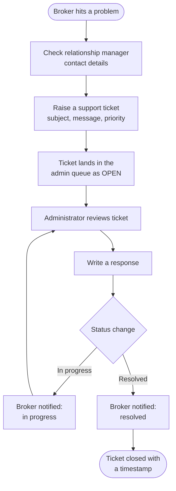

# Experiment 7: Sequence and Activity Diagrams

## Aim

To model the dynamic behaviour of the **InventoryOne: Broker Web App** by preparing UML Sequence Diagrams (object interactions over time) and Activity Diagrams (workflow with decisions and responsibilities) for its key scenarios.

## Objectives

- Select the key scenarios from the approved use cases (Experiment 5).
- Show how objects of the class model (Experiment 6) collaborate, using sequence diagrams.
- Show the step-by-step workflow, decisions and loops, using activity diagrams with swimlanes.
- Include alternative and exception flows (invalid OTP, unavailable plot, early exit, approval failure).
- Trace every diagram back to use cases, classes and SRS requirements.

## Introduction

The use case and class diagrams describe what the system does and what it is made of. Sequence and activity diagrams describe how it behaves. A sequence diagram shows the order of messages exchanged between objects for one scenario. An activity diagram shows the flow of actions, decisions and parallel paths of a process, and who is responsible for each action.

## Selected Project

**Project Title:** InventoryOne — Broker Web App
**Domain:** Real Estate / Property Management
**Team:** Avni, Ayushi

---

## Selection of Scenarios

The scenarios were chosen because they cover the primary use cases, involve the most objects, and contain meaningful alternative flows. Browsing, KYC and administration scenarios follow the same pattern and are not repeated.

| Scenario | Use Cases | Sequence Diagram | Activity Diagram |
| -------- | --------- | ---------------- | ---------------- |
| Broker registration and login | UC-01, UC-02 | Diagram 1 (login) | Diagram 1 |
| Raise a booking request | UC-07, UC-06 | Diagram 2 (booking) | Diagram 2 |
| Administrator approves a booking | UC-08 | Diagram 3 (approval) | Diagram 3 |
| Live inventory update | UC-04 | Diagram 4 (live) | – |

## Participants Used

| Participant | Role in the Scenarios |
| ----------- | --------------------- |
| Broker | Actor who performs the actions |
| React UI | Front end running in the browser; sends requests and shows results |
| Django REST API | Back-end entry point; routes requests to services |
| PostgreSQL | Database for brokers, projects, plots, customers, bookings, commissions |
| Redis (channel layer) | Message broker for live inventory broadcasts |
| Celery worker | Background worker for demand letters and notification fan-out |
| ActivityLogger / AuditService | Logger for events (never OTPs or secrets) |

---

## Sequence Diagram 1: Broker Login with OTP



## Sequence Diagram 2: Raise a Booking Request

```mermaid
sequenceDiagram
    actor Broker
    participant UI as Project Detail
    participant API as Django REST API
    participant DB as PostgreSQL
    participant WS as Channels (Redis)

    Broker->>UI: Select an available plot
    UI->>API: GET /api/projects/<id>/
    API->>DB: Query project + plots
    API-->>UI: 200 OK { plots with status }
    UI-->>Broker: Colour-coded plot grid

    Broker->>UI: Click plot, fill token amount + payment mode
    UI->>API: POST /api/bookings/
    API->>DB: BEGIN; SELECT ... FOR UPDATE plot
    alt plot not available
        API->>DB: ROLLBACK
        API-->>UI: 409 Conflict
    else available
        API->>DB: INSERT booking (pending)
        API->>DB: UPDATE plot status = on_hold
        API->>DB: COMMIT
        API->>WS: broadcast inventory update
        API-->>UI: 201 Created { booking }
        UI-->>Broker: "Booking request raised"
    end
```

## Sequence Diagram 3: Administrator Approves a Booking



## Sequence Diagram 4: Live Inventory Update



---

## Activity Diagram 1: Broker Onboarding and Booking Lifecycle



## Activity Diagram 2: Administrator Managing the Booking Queue



## Activity Diagram 3: Support Request Handling



---

## Description of the Diagrams

### Sequence Diagram 1: Broker Login with OTP

- **Purpose:** shows how a person is authenticated (UC-01, UC-02).
- **Main flow:** the broker submits an e-mail in the React UI; the request goes to the Django REST API, which gets or creates the `User` and `Broker` profile, generates a 6-digit OTP with a 5-minute expiry, and returns it (echoed in development). The broker enters the OTP; the API validates it, deletes it (single use), creates a DRF token, and returns the role so the UI can open the dashboard.
- **Alternative flow:** for an invalid or expired OTP the API returns 400 and the broker is asked to retry.

### Sequence Diagram 2: Raise a Booking Request

- **Purpose:** shows how a booking is created and how the plot is reserved (UC-06, UC-07).
- **Main flow:** the broker selects an available plot; the UI fetches the project detail. After the broker fills in the customer, token amount and payment mode, the API locks the plot with `SELECT ... FOR UPDATE`, creates a `pending` booking, sets the plot to `on_hold`, commits, and broadcasts an inventory update over Redis so every dashboard refreshes.
- **Alternative flow:** if the plot is no longer available the API returns 409 and the plot is not reserved.

### Sequence Diagram 3: Administrator Approves a Booking

- **Purpose:** shows how a booking is decided (UC-08).
- **Main flow:** the administrator opens the pending queue, reviews a booking, and clicks Approve. The API marks the booking `approved`, the plot `sold`, creates the `Commission` with 10% TDS, writes an `AuditLog` entry, notifies the broker, schedules the demand-letter generation as a Celery task, and broadcasts an inventory update.
- **Alternative flow:** on rejection the booking is marked `rejected`, the plot returns to `available`, and the broker is notified.

### Sequence Diagram 4: Live Inventory Update

- **Purpose:** shows how a plot change reaches every open dashboard (UC-04).
- **Main flow:** the broker dashboard opens a WebSocket to `/ws/inventory/` and joins the `inventory` group. When an administrator approves a booking, the API updates the plot and pushes an `inventory_update` event through the Redis channel layer; the consumer forwards it to every connected client, which re-fetches the project. If the socket cannot open, the client falls back to 15-second polling.

### Activity Diagram 1: Broker Onboarding and Booking Lifecycle

Shows the full journey from sign-in to commission release, with decisions for KYC approval, plot availability, customer registration, and the administrator's approve/reject decision. The alternative paths (rejection, early exit) keep the plot inventory consistent.

### Activity Diagram 2: Administrator Managing the Booking Queue

Shows the administrator's workflow: reviewing the dashboard statistics, inspecting a booking, querying the broker via a support ticket when details are wrong, and approving or rejecting. On approval the plot is marked sold, the commission is computed, the audit log is written, and the broker is notified.

### Activity Diagram 3: Support Request Handling

Shows how a broker raises a ticket, how it lands in the admin queue, and how the administrator responds and resolves it, with the broker receiving a notification at each status change.

---

## Observation

Sequence diagrams make the order of messages and the role of each class clear, and expose the alternative paths that must be coded and tested (invalid OTP, unavailable plot, early exit, approval failure). Activity diagrams show the overall workflow and responsibilities, and the swimlanes show where the administrator, the broker and the system are involved. Together they confirm that the classes of Experiment 6 can realise the use cases of Experiment 5.

## Result

UML Sequence Diagrams and Activity Diagrams were successfully prepared for the key scenarios of the InventoryOne Broker Web App: broker login and OTP verification, raising a booking request, administrator approval, live inventory update, and support request handling, with their alternative flows and traceability to the use cases, classes and SRS requirements.
