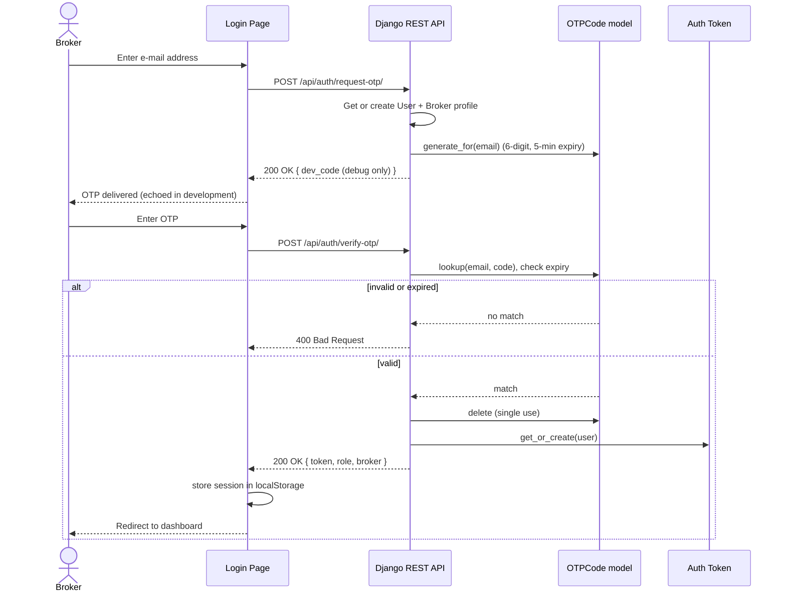
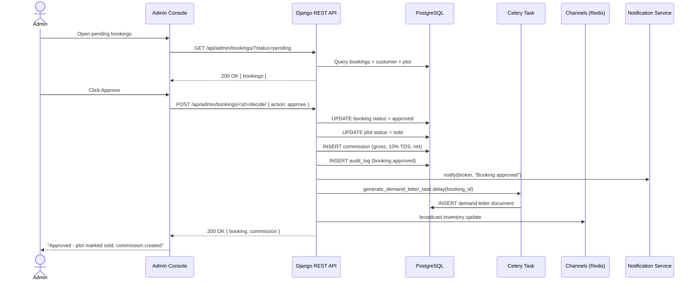
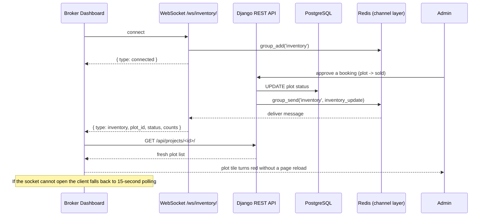

# Sequence Diagrams

## 1. Broker login with OTP



## 2. Raise a booking request

```mermaid
sequenceDiagram
    actor Broker
    participant UI as Project Detail
    participant API as Django REST API
    participant DB as PostgreSQL
    participant WS as Channels (Redis)

    Broker->>UI: Select an available plot
    UI->>API: GET /api/projects/<id>/
    API->>DB: Query project + plots
    API-->>UI: 200 OK { plots with status }
    UI-->>Broker: Colour-coded plot grid

    Broker->>UI: Click plot, fill token amount + payment mode
    UI->>API: POST /api/bookings/
    API->>DB: BEGIN; SELECT ... FOR UPDATE plot
    alt plot not available
        API->>DB: ROLLBACK
        API-->>UI: 409 Conflict
    else available
        API->>DB: INSERT booking (pending)
        API->>DB: UPDATE plot status = on_hold
        API->>DB: COMMIT
        API->>WS: broadcast inventory update
        API-->>UI: 201 Created { booking }
        UI-->>Broker: "Booking request raised"
    end
```

## 3. Administrator approves a booking



## 4. Live inventory update


