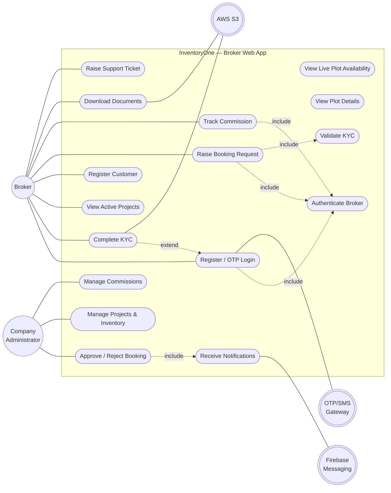

# Experiment 5: Use Case Diagram and Use Case Descriptions

## Aim

To identify the actors and use cases from the approved requirements of the **InventoryOne: Broker Web App**, and to prepare the UML Use Case Diagram together with the corresponding use case descriptions/narratives.

## Objectives

- Identify the actors (primary, secondary, external hardware, other systems).
- Identify the use cases supported by the system.
- Draw the UML Use Case Diagram with system boundary and relationships (association, include, extend).
- Document representative use case narratives using the generic use case format.
- Trace use cases to the functional requirements/SRS.

## Introduction

A Use Case Diagram establishes the capability of the system as a whole, showing *who* uses the system and *what* the system does without revealing its internal structure. It consists of actors, use cases, the system boundary, and relationships. Each use case is a sequence of related transactions (a dialogue) between an actor and the system.

---

# 1. Conceptual Description

## 1.1 Components of a Use Case Diagram

| Component       | Description                                                   |
| --------------- | ------------------------------------------------------------ |
| Actor           | Someone or something that interacts with the system          |
| Use Case        | A pattern of behaviour the system exhibits                    |
| System Boundary | A rectangle separating internal (system) from external (actors) |
| Relationship    | Association (communicates), Include (`<<include>>`), Extend (`<<extend>>`) |

## 1.2 Categories of Actors

- **Primary:** who uses the main system functions — *Broker*.
- **Secondary:** who takes care of administration and maintenance — *Company Administrator*.
- **External hardware:** hardware devices in the application domain — *none required* (standard browser device only).
- **Other system:** other systems the system must interact with — *OTP/SMS Gateway, AWS S3, Firebase Cloud Messaging, Google Maps API*.

## 1.3 Use Case Relationships

- **Association / Communicates:** links an actor to the use cases it participates in.
- **Include (`<<include>>`):** common behaviour shared by multiple use cases, extracted into a separate use case (e.g., *Authenticate Broker* is included by all broker use cases; *Validate KYC* is included by *Raise Booking Request*).
- **Extend (`<<extend>>`):** optional behaviour required only under certain conditions (e.g., *Upload KYC Documents* extends *Complete KYC*).

---

# 2. Actors Identified

| Actor                    | Type            | Description                                                       |
| ------------------------ | --------------- | ----------------------------------------------------------------- |
| Broker                   | Primary         | Registers, completes KYC, views inventory, books plots, tracks commissions |
| Company Administrator    | Secondary       | Manages projects/inventory, approves bookings, manages commissions |
| OTP/SMS Gateway          | Other System    | Delivers one-time passwords                                       |
| AWS S3                   | Other System    | Stores KYC and project documents                                  |
| Firebase Cloud Messaging | Other System    | Delivers push notifications                                       |
| Google Maps API          | Other System    | Displays project locations                                        |

---

# 3. Use Cases Identified

| ID    | Use Case                    | Primary Actor          | Traces to |
| ----- | --------------------------- | ---------------------- | --------- |
| UC-01 | Register / OTP Login        | Broker                 | FR-01–04  |
| UC-02 | Complete KYC                | Broker                 | FR-05–08  |
| UC-03 | View Active Projects        | Broker                 | FR-09     |
| UC-04 | View Live Plot Availability | Broker                 | FR-10,11  |
| UC-05 | View Plot Details           | Broker                 | FR-12     |
| UC-06 | Register Customer           | Broker                 | FR-13,14  |
| UC-07 | Raise Booking Request       | Broker                 | FR-15–17  |
| UC-08 | Approve / Reject Booking    | Company Administrator  | FR-18,19  |
| UC-09 | Track Commission            | Broker                 | FR-20–22  |
| UC-10 | Download Documents          | Broker                 | FR-23     |
| UC-11 | Receive Notifications       | Broker                 | FR-24     |
| UC-12 | Raise Support Ticket        | Broker                 | FR-25,26  |
| UC-13 | Manage Projects & Inventory | Company Administrator  | FR-27     |
| UC-14 | Manage Commissions          | Company Administrator  | FR-28,29  |

---

# 4. UML Use Case Diagram

> Note: GitHub renders the diagram above with Mermaid. For Draw.io, create a **System Boundary** rectangle, place the use cases inside it, the actors outside, and connect them with associations, `<<include>>` and `<<extend>>` dashed arrows.

**Relationship summary**

- `Broker` communicates with UC-01…UC-07, UC-09, UC-10, UC-12.
- `Company Administrator` communicates with UC-08, UC-13, UC-14.
- *Authenticate Broker* (`<<include>>`) is shared by UC-01, UC-07 and UC-09.
- *Validate KYC* (`<<include>>`) is shared by UC-07.
- *Upload KYC Documents* (`<<extend>>`) extends UC-02 conditionally.
- *Receive Notifications* (`<<include>>`) is triggered on booking decisions (UC-08).

---

# 5. Use Case Descriptions / Narratives

## UC-01: Register / OTP Login

- **Pre-condition:** The broker has a valid e-mail/mobile number.
- **Use case:** Register / OTP Login.
- **Actors:** Broker (initiator), OTP/SMS Gateway.
- **Purpose:** Verify the broker's identity and grant access to the platform.
- **Overview:** The broker submits e-mail, receives an OTP, and verifies it.
- **Type:** Primary.
- **Post-condition:** The broker is authenticated and logged in.

**Typical Course of Events**

| ACTOR ACTION                                          | SYSTEM RESPONSE                                                          |
| ----------------------------------------------------- | ------------------------------------------------------------------------ |
| 1. Broker opens the login page and enters e-mail.     | 2. System creates/fetches the broker and generates an OTP.               |
|                                                       | 3. System sends the OTP via the OTP/SMS gateway.                         |
| 4. Broker enters the OTP.                             | 5. System validates the OTP and expiry.                                  |
|                                                       | 6. System authenticates the broker and returns an access token.          |
| 7. Broker is redirected to the dashboard.             | 8. System displays active projects on the dashboard.                     |

**Alternative Flow**

- 5a. Invalid or expired OTP → System displays an error and requests the OTP again.
- 4a. Broker has no profile → System creates a new broker profile (KYC pending) and includes UC-02.

---

## UC-02: Complete KYC

- **Pre-condition:** The broker is authenticated.
- **Use case:** Complete KYC.
- **Actors:** Broker, AWS S3.
- **Purpose:** Verify the broker's identity and eligibility.
- **Overview:** The broker uploads documents and submits KYC and bank details.
- **Type:** Primary.
- **Post-condition:** KYC status is set to *pending* for administrator review.

**Typical Course of Events**

| ACTOR ACTION                                              | SYSTEM RESPONSE                                          |
| --------------------------------------------------------- | -------------------------------------------------------- |
| 1. Broker opens the KYC screen.                           | 2. System displays the KYC form.                         |
| 3. Broker uploads PAN, Aadhaar, GST and cancelled cheque. | 4. System stores documents in AWS S3.                    |
| 5. Broker enters RERA and bank details and accepts the agreement. | 6. System validates and saves the KYC data.       |
|                                                           | 7. System sets KYC status to *pending* and confirms.     |

**Alternative Flow**

- 6a. Missing or invalid fields → System highlights the fields and blocks submission.

---

## UC-03: View Active Projects

- **Pre-condition:** The broker is authenticated.
- **Use case:** View Active Projects.
- **Actors:** Broker.
- **Purpose:** Browse available inventory across active projects.
- **Overview:** The broker views a list of active projects with availability summaries.
- **Type:** Primary.
- **Post-condition:** The broker selects a project to view its plots.

**Typical Course of Events**

| ACTOR ACTION                                  | SYSTEM RESPONSE                                              |
| --------------------------------------------- | ------------------------------------------------------------ |
| 1. Broker opens the Projects screen.          | 2. System lists active projects with available/on-hold/sold counts. |
| 3. Broker selects a project.                  | 4. System displays the plot grid (UC-04).                    |

---

## UC-04: View Live Plot Availability

- **Pre-condition:** The broker has selected a project.
- **Use case:** View Live Plot Availability.
- **Actors:** Broker.
- **Purpose:** Identify which plots are available, on hold or sold.
- **Overview:** Plots are shown as a colour-coded grid (green/amber/red).
- **Type:** Primary.
- **Post-condition:** Availability is displayed and refreshed in real time.

**Typical Course of Events**

| ACTOR ACTION                                  | SYSTEM RESPONSE                                          |
| --------------------------------------------- | -------------------------------------------------------- |
| 1. Broker views the plot grid.                | 2. System shows plots colour-coded by status.            |
|                                               | 3. System refreshes availability via WebSocket updates.  |

---

## UC-05: View Plot Details

- **Pre-condition:** The broker has selected a plot.
- **Use case:** View Plot Details.
- **Actors:** Broker.
- **Purpose:** Inspect the size, facing and pricing of a plot.
- **Overview:** The system displays size, facing, PLC, BSP, discount and total cost.
- **Type:** Primary.
- **Post-condition:** The broker may proceed to book the plot (UC-07).

---

## UC-06: Register Customer

- **Pre-condition:** The broker is authenticated.
- **Use case:** Register Customer.
- **Actors:** Broker.
- **Purpose:** Record customer details for a booking.
- **Overview:** The broker enters customer name, phone, e-mail and address.
- **Type:** Primary.
- **Post-condition:** The customer is linked to the broker.

**Typical Course of Events**

| ACTOR ACTION                                   | SYSTEM RESPONSE                                       |
| ---------------------------------------------- | ----------------------------------------------------- |
| 1. Broker opens the Register Customer form.    | 2. System displays the form.                          |
| 3. Broker enters customer details and submits. | 4. System validates and saves the customer.           |
|                                                | 5. System confirms registration and links the customer to the broker. |

---

## UC-07: Raise Booking Request

- **Pre-condition:** The broker and customer exist and the plot is *available*.
- **Use case:** Raise Booking Request.
- **Actors:** Broker.
- **Purpose:** Place a booking for a customer on a chosen plot.
- **Overview:** The broker selects the plot and customer, enters token amount and payment mode, and submits.
- **Type:** Primary.
- **Post-condition:** A *pending* booking is created and the plot is placed *on hold*.

**Typical Course of Events**

| ACTOR ACTION                                         | SYSTEM RESPONSE                                          |
| ---------------------------------------------------- | -------------------------------------------------------- |
| 1. Broker selects an available plot and clicks Book. | 2. System includes *Authenticate Broker* and *Validate KYC*. |
| 3. Broker selects/creates a customer.                | 4. System loads the customer (or includes UC-06).        |
| 5. Broker enters token amount and payment mode.      | 6. System validates inputs.                              |
|                                                      | 7. System creates a *pending* booking.                   |
|                                                      | 8. System sets the plot status to *on hold*.             |
|                                                      | 9. System confirms the request and notifies the administrator. |

**Alternative Flow**

- 6a. Plot is no longer available → System rejects the request with a conflict message.

---

## UC-08: Approve / Reject Booking

- **Pre-condition:** A *pending* booking exists.
- **Use case:** Approve / Reject Booking.
- **Actors:** Company Administrator.
- **Purpose:** decide on booking requests.
- **Overview:** The administrator reviews pending bookings and approves or rejects each.
- **Type:** Secondary.
- **Post-condition:** The booking is *approved* (plot sold, commission created) or *rejected* (plot released).

**Typical Course of Events**

| ACTOR ACTION                                       | SYSTEM RESPONSE                                               |
| -------------------------------------------------- | ------------------------------------------------------------- |
| 1. Administrator opens the pending bookings list.  | 2. System lists pending bookings with customer and plot details. |
| 3. Administrator selects a booking.               | 4. System displays full details.                              |
| 5. Administrator clicks Approve.                   | 6a. System marks the booking *approved* and the plot *sold*.  |
|                                                    | 7a. System computes commission with TDS and notifies the broker (UC-11). |
| 5b. Administrator clicks Reject.                   | 6b. System marks the booking *rejected* and releases the plot to *available*. |

---

## UC-09: Track Commission

- **Pre-condition:** The broker has at least one approved booking.
- **Use case:** Track Commission.
- **Actors:** Broker.
- **Purpose:** View earned commission, TDS and net payable.
- **Overview:** The broker views a list of commissions with amounts and release status.
- **Type:** Primary.
- **Post-condition:** The broker sees the current commission ledger.

---

## UC-10: Download Documents

- **Pre-condition:** The broker is authenticated.
- **Use case:** Download Documents.
- **Actors:** Broker, AWS S3.
- **Purpose:** Obtain price lists and booking forms.
- **Overview:** The broker downloads documents served from AWS S3.
- **Type:** Primary.
- **Post-condition:** The document is downloaded.

---

## UC-11: Receive Notifications

- **Pre-condition:** The broker is registered for notifications.
- **Use case:** Receive Notifications.
- **Actors:** Broker, Firebase Cloud Messaging.
- **Purpose:** Keep the broker informed about projects, schemes and booking decisions.
- **Overview:** The system pushes notifications when events occur.
- **Type:** Primary.
- **Post-condition:** The broker has received the notification.

---

## UC-12: Raise Support Ticket

- **Pre-condition:** The broker is authenticated.
- **Use case:** Raise Support Ticket.
- **Actors:** Broker.
- **Purpose:** Report an issue or contact the relationship manager.
- **Overview:** The broker submits a ticket; the system shows relationship manager contact details.
- **Type:** Primary.
- **Post-condition:** A support ticket is created.

---

## UC-13: Manage Projects & Inventory

- **Pre-condition:** The administrator is authenticated.
- **Use case:** Manage Projects & Inventory.
- **Actors:** Company Administrator.
- **Purpose:** Create and maintain projects and plots.
- **Overview:** The administrator adds/edits projects and plot records and their pricing.
- **Type:** Secondary.
- **Post-condition:** Project and inventory master data are updated.

---

## UC-14: Manage Commissions

- **Pre-condition:** Approved bookings with commissions exist.
- **Use case:** Manage Commissions.
- **Actors:** Company Administrator.
- **Purpose:** Release commissions and generate demand letters.
- **Overview:** The administrator reviews commissions, releases payments and generates demand letters.
- **Type:** Secondary.
- **Post-condition:** Commission release status and demand letters are updated.

---

## Observation

Actors and use cases were identified from the approved SRS, the UML Use Case Diagram was prepared with the system boundary and include/extend relationships, and representative use case narratives were documented using the generic use case format.

## Result

The actors, use cases, UML Use Case Diagram, and use case descriptions for the InventoryOne: Broker Web App were successfully prepared and trace back to the functional requirements in the SRS.
