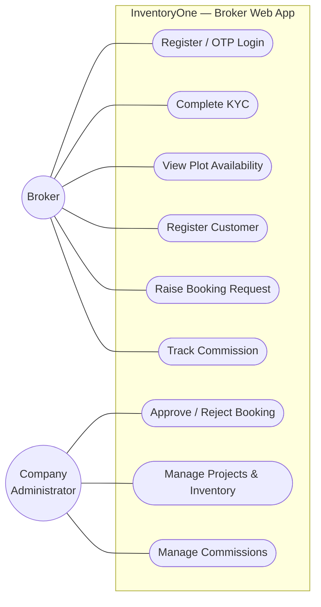
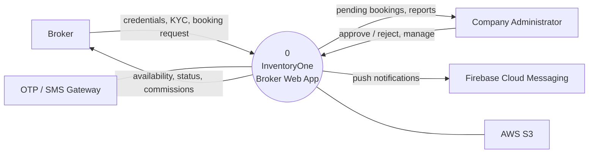
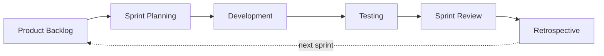

<!-- _class: lead -->
<!-- _paginate: false -->

# InventoryOne
### Broker Web App — Real-Estate Plot Booking Platform

**Selected Software System:** A digital platform where registered brokers view live plot inventory, register customers, raise booking requests, track commissions and receive notifications.

**Group Members:** Avni · Ayushi  
**Domain:** Real Estate / Property Management · **Methodology:** Agile

---

## 2. Introduction, Problem Statement & Objectives

### Introduction
- Real-estate plot booking today relies on manual coordination between brokers and the company.
- Brokers must call/visit the office to check availability, raise bookings and track earnings.
- **InventoryOne** is a self-service web app giving brokers live plot visibility and digital bookings.
- Administrators manage projects, inventory, approvals and commissions from one dashboard.

### Problem Statement
- Stale inventory data and no live visibility of plot availability.
- Slow, error-prone booking through phone/email and spreadsheets.
- No transparent commission tracking for brokers.
- Limited service hours and heavy manual coordination.

### Objectives
- Secure OTP-based broker login and KYC verification.
- Live, colour-coded plot availability.
- Customer registration and booking with approval.
- Automated commission, TDS and documents.
- Real-time notifications and support tickets.

---

## 3. Major Functional & Non-Functional Requirements

### Functional Requirements
- OTP-based broker registration, login and session expiry.
- KYC upload (PAN, Aadhaar, GST, cancelled cheque) + RERA & bank details.
- Active project listing with project details.
- Live colour-coded plot availability: available on hold sold
- Plot details: size, facing, PLC, BSP, total cost, discount.
- Customer registration linked to the broker.
- Booking requests with token amount and payment mode.
- Administrator approval / rejection of bookings.
- Commission tracking with TDS and net payable; document downloads.
- Notifications and support tickets.

### Non-Functional Requirements
- **Usability:** simple, minimal training.
- **Performance:** operations respond < 2 s.
- **Security:** role-based access; HTTPS; protected OTP/KYC.
- **Reliability:** no loss of booking/commission data.
- **Scalability:** supports more projects, plots, brokers.
- **Maintainability:** modular and documented.
- **Responsiveness:** desktop and mobile.

---

## 4. Actors & UML Use Case Diagram

**Actors:** Broker (primary) · Company Administrator (secondary)  
**External systems:** OTP/SMS Gateway, AWS S3, Firebase FCM, Google Maps  
**Relationships:** `<<include>>` Authenticate Broker & Validate KYC · `<<extend>>` Upload KYC Documents

---

## 5. Data Flow Diagram — DFD Level 0 (Context)

**Level 1 processes:** 1.0 Authentication · 2.0 KYC · 3.0 Project & Inventory · 4.0 Customer & Booking · 5.0 Commission · 6.0 Notification  
**Data stores:** D1 Brokers · D2 Projects/Plots · D3 Customers · D4 Bookings · D5 Commissions

---

## 6. Software Architecture & Major Modules

**Presentation Layer** — Next.js + TypeScript · Broker & Admin web UI (responsive)

**API Layer** — Django REST Framework · OTP / Token auth · REST endpoints

**Business / Application Modules** — Auth · KYC · Project & Inventory · Customer · Booking · Commission · Notification · Support · Admin

**Data & External Services** — PostgreSQL · Redis · AWS S3 · Firebase FCM · Google Maps · OTP/SMS Gateway

### Major Modules
- Authentication (OTP)
- KYC Verification
- Project & Inventory
- Customer Management
- Booking & Approval
- Commission & TDS
- Notification
- Documents
- Support Tickets
- Admin & Reports

---

## 7. Module Cohesion, Coupling & Design Considerations

### Cohesion — High / Functional
- Each module performs exactly one responsibility.
- Auth → only identity verification.
- KYC → only document handling.
- Commission → only commission & TDS.
- Notification → only message delivery.
- *Benefit:* easier testing, reuse, maintenance.

### Coupling — Low
- Modules communicate via clean interfaces.
- Auth ↔ OTP gateway → **message** coupling.
- Booking ↔ Inventory → **data** coupling.
- Admin → Booking → **control** coupling.
- *Benefit:* changes stay localised.

### Design Considerations
- Modularization & information hiding.
- Abstraction hides implementation.
- **SOLID:** SRP, OCP, LSP, ISP, DIP.
- OO model: Broker, Project, Plot, Customer, Booking, Commission.
- Top-down decomposition + bottom-up integration.

---

## 8. SDLC Model — Agile

### Justification
- Requirements **evolve** — Agile supports change through short sprints.
- Delivers **working increments** early (auth → inventory → booking → commission).
- Continuous testing and broker feedback improve quality.
- Two-member team suits short, focused iterations.
- **Sprint plan (1–6):** setup → DB/login/KYC → inventory → booking → commission → notifications.
- Git feature branches + pull requests enable collaboration.

---

## 9. Major Challenges, Security Concerns & Improvements

### Major Challenges
- Ensuring real-time availability accuracy.
- Preventing double booking of a plot.
- Handling KYC uploads and validation.
- Integrating multiple third-party services.
- Accurate commission and TDS computation.

### Security Concerns
- OTP reuse / brute-force attempts.
- Protecting sensitive KYC & bank data.
- Role-based access for admin functions.
- Secure document storage (S3, encryption).
- HTTPS everywhere; no secrets in logs.

### Possible Improvements
- Integrated payment gateway & digital demand letters.
- QR-based booking and biometric login.
- Analytics dashboard for sales & inventory.
- Offline / PWA support and native mobile app.
- AI-based lead & price recommendations.

---

## 10. Key Learnings & Conclusion

### Key Learnings
- Applied the full SDLC: requirements → design → implementation.
- Wrote a structured SRS traced to user stories.
- Modelled actors, use cases and data flows.
- Understood modularity, high cohesion, low coupling.
- Practised Agile sprints and Git/GitHub collaboration.
- Learned secure design for sensitive broker/KYC data.

### Conclusion
- InventoryOne digitises real-estate plot booking for brokers.
- Provides live inventory, digital bookings and transparent commissions.
- A modular, secure, scalable and maintainable web application.
- Built iteratively with Agile, enabling continuous improvement.
- Foundation ready for payments, analytics and mobile expansion.

<!-- _paginate: false -->
### Thank You
